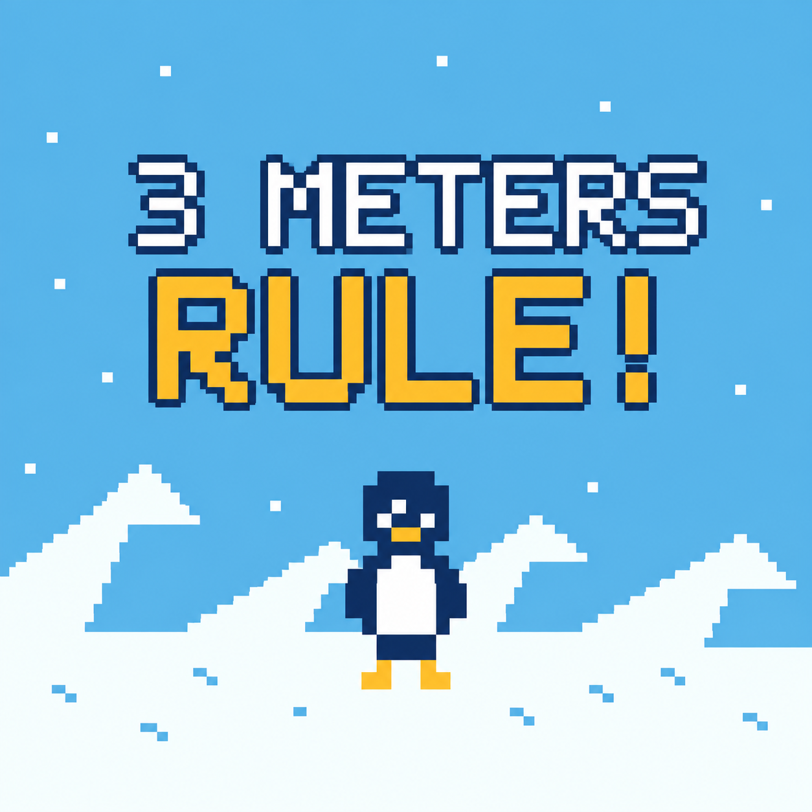

# 3 Meters Rule!

南極の雪原で、人懐っこいペンギンを避けながら観測基地への帰還を目指すGBC用逃走アクションです。
ダッシュとアイテムを使って全3ステージをクリアし、合計クリア時間を縮めよう。
観測基地の入口のドアに触れると成功し、次のステージへ進みます。
ステージ1は滑りを横に避け、2はスノーシューで深雪を横断、3は魚袋でペンギンを誘導して近道を狙おう。
各ステージでペンギンに3回触れるとゲームオーバーです。
STARTで始めると雪上車が停車し、隊員が降りた後に操作できます。約2.5秒の演出はクリア時間に含めません。

[ダウンロード](https://github.com/machitomo/3-Meters-Rule-releases/releases/latest)

## ブラウザ版
ブラウザ版（EmulatorJS）は [itch.io](https://hothiyachu.itch.io/3-meters-rule) で公開しています。

## 操作

| ボタン | 操作 |
|---|---|
| 十字キー | 8方向に移動 |
| A | 所持アイテムを使用 |
| B | 押している間ダッシュ |
| START | 開始・ポーズ／再開・リトライ |
| SELECT | ポーズ・ゲームオーバー・結果画面からタイトルへ |
